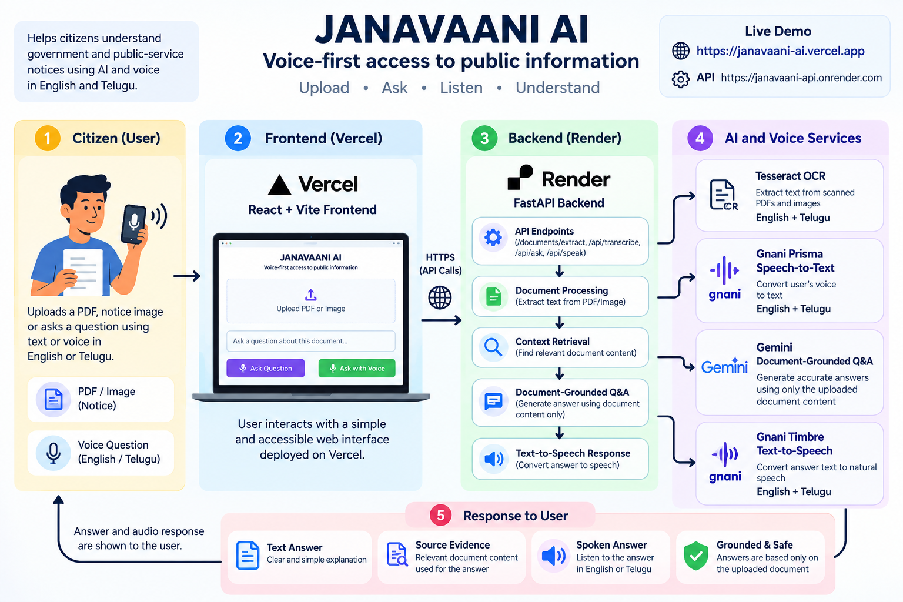

# JANAVAANI AI

**Voice-first access to public information**

JANAVAANI AI is a bilingual, voice-first assistant designed to help citizens understand government and public-service notices more easily.

Users can upload a PDF, scanned document, or notice image and ask questions about it using text or voice in English or Telugu. JANAVAANI extracts the document content, answers questions using the uploaded document as its source, shows supporting evidence, and can speak the answer back to the user.

## Live Demo

https://janavaani-ai.vercel.app

## Why JANAVAANI?

Government notices often contain important information about eligibility, deadlines, required documents, benefits, and application procedures.

However, citizens may face difficulties because of:

- complex official language
- long documents
- language barriers
- scanned or photographed notices
- difficulty locating specific information
- limited accessibility for users who prefer voice

JANAVAANI turns these notices into an interactive question-answering experience.

## Key Features

### PDF and Image Understanding

Supports:

- PDF
- JPG
- JPEG
- PNG

Selectable PDF text is extracted directly. Scanned PDFs and images are processed using OCR.

### English and Telugu OCR

Tesseract OCR is configured with English and Telugu language support, allowing JANAVAANI to understand photographed and scanned regional-language notices.

### Document-Grounded Q&A

Users can ask questions about an uploaded notice and receive answers grounded in the document content.

If the requested information is not available in the uploaded document, JANAVAANI avoids answering using unrelated outside knowledge.

### Voice Questions

JANAVAANI integrates **Gnani Prisma Speech-to-Text** to allow users to ask questions using their voice.

Supported languages currently include:

- English
- Telugu

### Spoken Answers

Answers can be converted into speech using **Gnani Timbre Text-to-Speech**, making information easier to access for users who prefer listening.

### Source Evidence

JANAVAANI displays the relevant document context used to produce the answer, improving transparency and trust.

## How It Works

```text
Citizen
   |
   v
Upload PDF / Notice Image
   |
   v
Text Extraction / OCR
   |
   v
Document Content
   |
   +-------------------------+
   |                         |
   v                         v
Text Question          Voice Question
                             |
                             v
                     Gnani Prisma STT
                             |
                             v
                       Question Text
                             |
                             v
                  Relevant Context Retrieval
                             |
                             v
                   Document-Grounded Q&A
                             |
                  +----------+----------+
                  |                     |
                  v                     v
             Text Answer          Source Evidence
                  |
                  v
            Gnani Timbre TTS
                  |
                  v
             Spoken Answer
```

## Gnani AI Integration

Gnani AI forms the voice layer of JANAVAANI.

### Gnani Prisma

Used for speech-to-text transcription.

```text
Citizen's voice
      ↓
Gnani Prisma
      ↓
English/Telugu transcript
      ↓
JANAVAANI question
```

### Gnani Timbre

Used for text-to-speech generation.

```text
JANAVAANI answer
      ↓
Gnani Timbre
      ↓
Generated speech
      ↓
Citizen listens to answer
```

Together, these APIs enable a voice-first experience for interacting with public-service information.

## Technology Stack

### Frontend

- React
- Vite
- Tailwind CSS
- JavaScript

### Backend

- FastAPI
- Python
- PyMuPDF
- Pillow
- Tesseract OCR

### AI and Voice

- Gnani Prisma — Speech-to-Text
- Gnani Timbre — Text-to-Speech
- Gemini — document-grounded answer generation

### Deployment

- Vercel — frontend
- Render — backend
- Docker — backend runtime and OCR dependencies

## System Architecture

## System Architecture



```text
                        JANAVAANI AI

                 ┌───────────────────────┐
                 │       Citizen         │
                 └───────────┬───────────┘
                             │
                  PDF / Image / Voice
                             │
                             v
                 ┌───────────────────────┐
                 │   React + Vite UI     │
                 │       Vercel          │
                 └───────────┬───────────┘
                             │ HTTPS
                             v
                 ┌───────────────────────┐
                 │    FastAPI Backend    │
                 │        Render         │
                 └───────────┬───────────┘
                             │
             ┌───────────────┼───────────────┐
             │               │               │
             v               v               v
       Tesseract OCR    Gnani Prisma     Gemini
       English/Telugu       STT          Q&A
             │               │               │
             └───────────────┴───────┬───────┘
                                     │
                                     v
                              Grounded Answer
                                     │
                          ┌──────────┴──────────┐
                          │                     │
                          v                     v
                    Source Evidence       Gnani Timbre
                                               TTS
                                                │
                                                v
                                         Spoken Answer
```

## Project Structure

```text
Janavaani-ai/
├── backend/
│   ├── app/
│   │   ├── main.py
│   │   ├── document_qa.py
│   │   ├── pdf_extract.py
│   │   ├── transcribe.py
│   │   └── tts.py
│   ├── Dockerfile
│   ├── requirements.txt
│   └── .env.example
│
├── frontend/
│   ├── src/
│   │   ├── App.jsx
│   │   ├── VoiceRecorder.jsx
│   │   └── assets/
│   ├── package.json
│   └── .env.example
│
├── .gitignore
└── README.md
```

## Running Locally

### Backend

Create a Python virtual environment and install the dependencies:

```bash
pip install -r requirements.txt
```

Install Tesseract OCR with English and Telugu language data.

Create `.env` inside `backend/`:

```env
GNANI_API_KEY=your_gnani_api_key
GEMINI_API_KEY=your_gemini_api_key
```

Run FastAPI:

```bash
uvicorn app.main:app --reload --port 8000
```

### Frontend

From the `frontend` directory:

```bash
npm install
npm run dev
```

Create a frontend `.env` when required:

```env
VITE_API_BASE_URL=http://localhost:8000
```

## Privacy and Security

API credentials are stored using environment variables and are not committed to the repository.

The frontend communicates with the backend API, while third-party AI credentials remain on the server side.

## Current Scope

JANAVAANI currently focuses on English and Telugu public-service documents.

The current version is an MVP demonstrating how OCR, document-grounded AI, and regional-language voice technologies can make public information easier to understand.

## Future Scope

Possible future improvements include:

- additional Indian languages
- improved semantic document retrieval
- multi-document conversations
- automatic notice summarization
- structured deadline and eligibility extraction
- low-bandwidth accessibility improvements
- integration with additional public-service information channels

## Built For

**Gnani AI — Great Indian AI Internship Challenge 2026**

JANAVAANI AI demonstrates how regional-language voice AI can help make important public information more accessible and understandable.